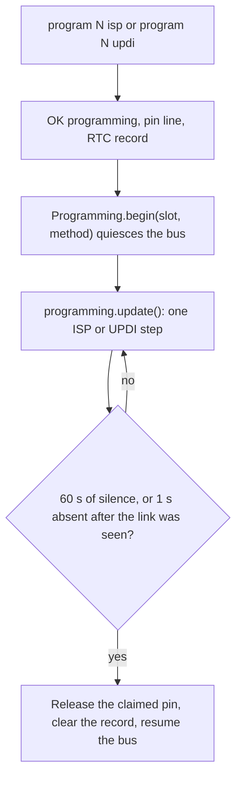

# Programming

[Home](home.md) · Reference: [Programming](reference/programming.md)

## Summary

`Programming` is one session on firmware slot 1 through 4. `program N isp` is SPI, for an ATmega328PB. `program N updi` is UPDI, for an ATtiny1614. A line without both a slot and a method replies `ERR program` and does not start a session. `check N` only measures that slot's CS pin.

SPI uses the shared MOSI, MISO, and SCK pins, plus that slot's CS pin as RESET. The clock is mode 0, MSB first, 125 kHz, and avrdude's baud does not change it. Reset is held low, programming enable waits 20 ms, and that try is repeated up to three times. A flash page then waits 5 ms, each EEPROM byte waits 10 ms, and chip erase waits 10 ms. The board check is signature `0x1E9516`.

UPDI uses only that slot's CS pin, at 115200 8E2 on UART1. The double break is 25 ms low, 3 ms with the input pull-up, then 25 ms low. The update that ends the break stores Control A `0x00`, a guard of 128 bit times (about 1.1 ms). A successful enter then stores Control A `0x03`, 16 bit times (about 139 µs), so a page finishes inside avrdude's receive window. Enter and leave wait up to 200 ms for status bits 1–3. Chip erase waits up to that same 200 ms for the lock bit to clear, answers OK when it does, and does not enter programming mode. A page program waits up to 20 ms. The board check is signature `0x1E9422`.

Pins, wire bytes, and the full timing tables are in the [programming reference](reference/programming.md).

## Where it sits

`main.cpp` constructs it with the USB byte port, the SPI master, the half-duplex UART, the four CS pins, `kProgrammingPins`, `ModuleBus`, the clock, `kProgrammingIdleTimeoutMs` (60 seconds), and `kProgrammingUnplugTimeoutMs` (1 second). `loop()` calls `network.update()` first. While `active()` is true it calls `programming.update()` and returns, unless the session ended on that pass.

`serialConsole.update()` recognizes the program line and returns before the bus. `loop()` then stores the RTC latch and calls `begin(slot, method)`. A `check` line does not store the latch. Each pass while the check is running polls one phase of the 25 ms / 3 ms / 25 ms break and returns before the bus and before `delay(10)`. The pass that finishes the second low claims the pin and reads STATUSA.

## What it creates

```text
main.cpp
  Programming
    ProgrammingSession     silence timer and the seen-then-absent unplug rule
    IspProgrammer          STK500v1 subset avrdude uses, 125 kHz SPI
    UpdiProgrammer         jtag2updi, push-pull bytes then release, 115200 8E2
```

`begin(slot, method)` quiesces the bus. A slot outside 1..4 returns without quiescing. A second `begin` while the session is active does not rebind the pin or the UART. While the session is active the console, the bus, and the type modules do not run. Wi-Fi, NTP, and MQTT do. Desired solenoid and pump commands wait, and their absence windows keep counting.

## One update



A USB-open restart keeps the record, so `setup()` enters the same slot and method without the banner and without `startController()`. The reset button and a power cycle clear it. An older single-word ISP marker does not resume. Pins, the two host tools, the wire sequences, and the `check` measurement are in the reference.

## What is stored, and who reads it

The latch is one record in RTC slow memory (`.rtc_noinit`): magic, slot, and method. `setup()` reads it. `loop()` clears it when the session ends. Ending the session does not reset the chip. If init already ran, the power-on lines are not printed again.

## See also

- [Programming reference](reference/programming.md) — jumper pins, SPI and UPDI timings, wire bytes, the unplug rule, tests.
- [Configuration reference](reference/configuration.md) — the accepted `program` and `check` lines, `ERR program`, and `ERR check`.
- [MQTT reference](reference/mqtt.md) — commands that can still arrive while a session is active.
- [Serial console](serial-console.md)
- [Module bus](module-bus.md)
- [Architecture](architecture.md)
