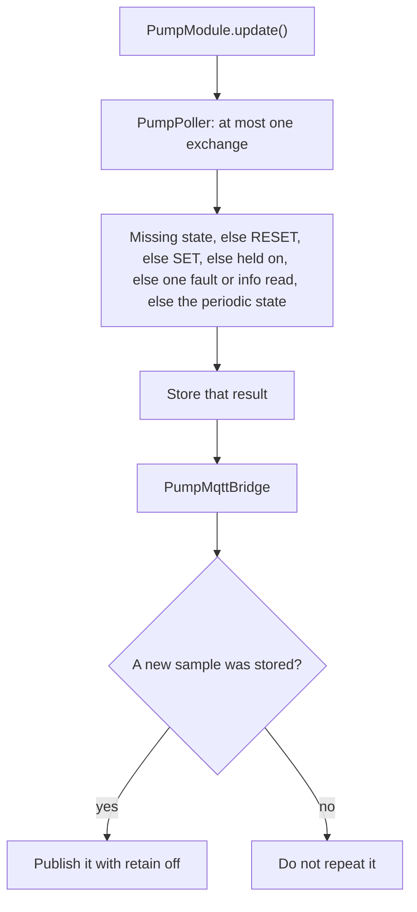

# Pump module

[Home](home.md) · Reference: [Pump](reference/pump-module.md)

## Summary

`PumpModule` talks to daughter boards of type `0x0300`. A board drives one pump. The module reads the state when the board is identified, reads it again on the poll interval, and publishes `on`, `off`, or `fault`. Held and running are both `on` on that topic. `{id}/pump` names the desired on or off state, or asks for a reset. Each accepted `on` sends `SET_PUMP` on, including when the pump is already on. While that command is still inside the absence window, the same on command is sent again every `kPumpPollIntervalMs`, and that reply is the state sample. Off is sent when the known state differs. `SET_PUMP` is not sent while the pump is faulted.

Once the state is known, the module also reads the live sample, the open cycle, and the lifetime totals. Each of those repeats every `kPumpInfoIntervalMs` (15 seconds). The first of each waits only for a free pass. A fault state is followed by one `GET_FAULT`, and the reason is published. That read is not repeated until the fault clears and a new one appears.

If no accepted on/off command arrives for `kPumpCommandTimeoutMs` (3 minutes), a pump that is on is turned off. A reset does not refresh that window, and it does not clear a fault by itself. `RESET_PUMP` is sent only after `{id}/pump` says `reset`. The info reads do not refresh the window either.

## Where it sits

`main.cpp` constructs it with `ModuleBus`, `Network`, the clock, `kPumpPollIntervalMs` (60 seconds), `kPumpCommandTimeoutMs` (3 minutes), and `kPumpInfoIntervalMs` (15 seconds). The constructor registers the `{id}/pump` handler. There is no subscription for the info topics. `loop()` calls `pumpModule.update()` after the solenoid module.

## What it creates

```text
main.cpp
  PumpModule
    PumpPoller         one query per pass; per-slot state, info samples, fault reason
    PumpMqttBridge     records on, off, or reset; publishes the stored samples
```

The callback only records the request. `ModuleHost` is the only I2C caller. This exchange is separate from the host transaction and from the sensor and solenoid queries.

## One update



Control still wins the pass. A reset waits until the state is known. When it returns off or on and the desired state still differs, a later pass sends `SET_PUMP`. A reset that still returns fault is published and not followed by `SET_PUMP`. Leaving a fault publishes `none 0` on the fault topic without another I2C read.

## What is stored, and who reads it

Each slot keeps its own state, desired on/off, poll timer, and the latest now, cycle, totals, and fault reason. The absence window is one timer for every pump: any accepted on/off command restarts it. Faulted pumps are not reset when the window elapses. The bridge publishes `{id}/slot/N/pump`, and `/now`, `/cycle`, `/totals`, and `/fault`, with retain off. A retained `on` stayed on the broker after the board was removed, and a new subscriber received it as if the pump were still there. `{id}/slot/N` stays retained. Unplug publishes `unavailable` once, with retain off, on each of those topics that had been published. A new identity that is still an online pump does not publish `unavailable` on the info topics. The retain rule is in the [pump reference](reference/pump-module.md).

Serial status prints the slot line only. The pump state is the MQTT payload.

## See also

- [Pump reference](reference/pump-module.md) — commands, info reads, reset, the cutoff, tests.
- [MQTT reference](reference/mqtt.md) — the pump topics, and a payload to publish when testing.
- [Daughter contract](daughter/contract.md)
- [Module bus](module-bus.md)
- [Architecture](architecture.md)
