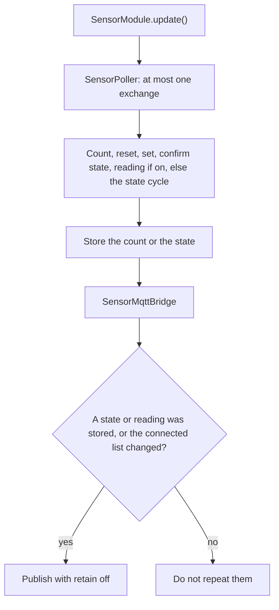

# Sensor module

[Home](home.md) · Reference: [Sensor](reference/sensor-module.md)

## Summary

`SensorModule` talks to daughter boards of type `0x0200`. A board reports up to 16 inputs. Each input stays off until `{id}/sensor` turns it on. The module reads that input's state, and it reads a raw value only while the state is on. Off, fault, and an empty jack are published from the state. A fault stays until an MQTT reset.

Wire indexes are 0-based. MQTT slot and sensor numbers are 1-based. The controller does not scale the value.

## Where it sits

`main.cpp` constructs it with `ModuleBus`, `Network`, the clock, and `kSensorPollIntervalMs` (60 seconds). The constructor registers one handler for `{id}/sensor`, `{id}/sensor/read`, and `{id}/sensor/connected`, before `Network::begin()`. `loop()` calls `sensorModule.update()` after `moduleBus.update()` and before the solenoid module.

## What it creates

```text
main.cpp
  SensorModule
    SensorPoller         one query per pass; per-slot count, desired state, and samples
    SensorMqttBridge     records commands and publishes stored state
```

`ModuleHost`, inside the bus, is the only I2C caller. The poller's exchange is separate from the one transaction inside `moduleBus.update()`.

## One update



`{id}/sensor` with `N M on`, `N M off`, or `N M reset` only records the request. The poller sends `SET_SENSOR` or `RESET_SENSOR` on a later pass, then reads `GET_SENSOR_STATE` on the next passes. An on result is followed by `GET_SENSOR_READING`, so the value is published without waiting out `kSensorPollIntervalMs`. `{id}/sensor/read` asks for one input and does not turn it on. `{id}/sensor/connected` only asks for the list of inputs whose state is on.

## What is stored, and who reads it

Each slot keeps its own count, the desired on or off for each input, a pending reset, the last state, and a reading when that state is on. The bridge publishes `{id}/slot/N/sensor/M` from that store, and `{id}/slot/N/sensors` as the count plus the indexes whose state is on. Those publishes are not retained. Unplug publishes `unavailable` once, with retain off. Another slot keeps its own cache.

There is no silence timer. An input that was turned on stays on until an off command, a fault, or the slot is cleared. On and off are ignored while the input is faulted. `reset` is the only command that clears a fault, and the module leaves that input off. If it is still desired on, a later pass sends `SET_SENSOR` on.

Serial status prints the slot line (`Online Sensor addr=0x10`). It does not print individual inputs.

## See also

- [Sensor reference](reference/sensor-module.md) — commands, poll order, publish rules, tests.
- [MQTT reference](reference/mqtt.md) — the sensor topics, and a payload to publish when testing.
- [Daughter contract](daughter/contract.md)
- [Module bus](module-bus.md)
- [Architecture](architecture.md)
